  

  

  
  

---

## 👨‍💻 About Me

I build **data pipelines and full-stack applications**, combining software engineering, data processing, and cloud technologies to develop scalable solutions.

My projects include document processing with Python and FastAPI, financial data engineering with Snowflake, dbt, and Airflow, and full-stack applications using React, Node.js, Express, and MongoDB.

🎓 **MS in Software Engineering Systems** — Northeastern University, Boston

💼 **Open to Data Engineering and Software Engineering opportunities**

---

## 🛠️ Tech Stack

### 🐍 Languages

`Python` · `JavaScript (ES6+)` · `SQL` · `HTML5` · `CSS3` · `SCSS`

### 📊 Data Engineering

`Snowflake` · `dbt` · `Apache Airflow` · `Data Modeling` · `ETL / ELT Pipelines` · `Jupyter Notebooks`

### 📄 Document AI & Extraction

`PDF Extraction` · `OCR` · `Table Recovery` · `Markdown Conversion` · `pdfplumber` · `PyPDF2` · `BeautifulSoup` · `Text Chunking`

### 🖥️ Backend & APIs

`FastAPI` · `Node.js` · `Express.js` · `REST APIs` · `JWT Authentication` · `bcrypt` · `Pydantic` · `OpenAPI / Swagger`

### 🎨 Frontend Development

`React 19` · `React Router` · `Axios` · `Tailwind CSS` · `Streamlit` · `HTML5 / CSS3 / SCSS`

### 🗄️ Databases

`MongoDB` · `Mongoose (Schemas, Indexes)` · `Snowflake` · `SQL`

### ☁️ Cloud & DevOps

`AWS S3 (boto3)` · `Azure AI Document Intelligence` · `Docker` · `GitHub Actions CI` · `pytest` · `Git / GitHub`

---

## 🚀 Featured Projects

### 📄 Document Processing Pipeline

**Python | FastAPI | Streamlit | AWS S3 | Azure AI**

A document processing application that extracts information from PDFs and web pages, converts content into structured Markdown, and supports multiple extraction engines.

**Highlights:**
- Integrates pdfplumber, Azure Document Intelligence, Docling, and MarkItDown.
- Extracts text, tables, and document content.
- Converts extracted information into structured Markdown.
- Uses FastAPI for backend services and Streamlit for the user interface.
- Supports AWS S3 storage.

🔗 [View Repository](https://github.com/DarshanGaviyappa/document-processing-pipeline)

### 📊 Financial Data Engineering — SEC Analysis

**Python | Snowflake | dbt | Apache Airflow**

A data engineering project focused on processing and modeling financial statement data from SEC filings.

**Highlights:**
- Builds financial data pipelines using Python.
- Uses Snowflake for cloud data warehousing.
- Applies dbt for data transformation and modeling.
- Uses Apache Airflow for workflow orchestration.
- Organizes financial data for analysis.

🔗 [View Repository](https://github.com/DarshanGaviyappa/findata-sec-analysis)

### 🌐 Caregiver Training Platform

**React | Node.js | Express | MongoDB | JWT**

A full-stack web application developed for caregiver training, assessment, and progress management.

**Highlights:**
- Developed eight interactive caregiver training modules.
- Integrated video content and 40+ assessment questions.
- Implemented JWT-based authentication and protected API routes.
- Built progress tracking, quizzes, and a points-based incentive system.
- Developed RESTful APIs with Express and MongoDB.
- Created responsive dashboards using React and Tailwind CSS.
- Designed multilingual content support.

🔗 [View Repository](https://github.com/DarshanGaviyappa/caregiver-training-platform)

---

## 📂 All Repositories by Technology

### 📊 Data Engineering, AI & Notebooks

| Repository | Technology Stack |
|------------|------------------|
| [document-processing-pipeline](https://github.com/DarshanGaviyappa/document-processing-pipeline) | Python, FastAPI, Streamlit, AWS S3, Azure |
| [findata-sec-analysis](https://github.com/DarshanGaviyappa/findata-sec-analysis) | Python, Snowflake, dbt, Apache Airflow |
| [Full-Atom-Generation-of-Antibody](https://github.com/DarshanGaviyappa/Full-Atom-Generation-of-Antibody) | Jupyter Notebook, Data Science |
| [Assignment-10](https://github.com/DarshanGaviyappa/Assignment-10) | Jupyter Notebook, Coursework |
| [ai-document-processor](https://github.com/DarshanGaviyappa/ai-document-processor) | Python, Early Document Processing Project |

### 🌐 Full-Stack Web Development

| Repository | Technology Stack |
|------------|------------------|
| [caregiver-training-platform](https://github.com/DarshanGaviyappa/caregiver-training-platform) | React, Node.js, Express, MongoDB, JWT |

### ☁️ Cloud Computing

| Repository | Technology Stack |
|------------|------------------|
| [Cloud-Assignment--2](https://github.com/DarshanGaviyappa/Cloud-Assignment--2) | JavaScript |
| [Cloud-Assignment-2](https://github.com/DarshanGaviyappa/Cloud-Assignment-2) | Cloud Computing Coursework |

<b>🌐 Web Coursework — JavaScript</b>

| Repository | Technology |
|------------|------------|
| [Web-Assignment-9](https://github.com/DarshanGaviyappa/Web-Assignment-9) | JavaScript |
| [WEB-Assignment-8](https://github.com/DarshanGaviyappa/WEB-Assignment-8) | JavaScript |
| [Web---Assignment7-Part-A](https://github.com/DarshanGaviyappa/Web---Assignment7-Part-A) | JavaScript |
| [WEB-Assignment-4](https://github.com/DarshanGaviyappa/WEB-Assignment-4) | JavaScript |
| [INFO6150-Assignment3](https://github.com/DarshanGaviyappa/INFO6150-Assignment3) | JavaScript |

<b>🎨 Web Coursework — HTML, CSS & SCSS</b>

| Repository | Technology |
|------------|------------|
| [Web-Assignment7-Part-B](https://github.com/DarshanGaviyappa/Web-Assignment7-Part-B) | CSS |
| [Web---Assignment-6](https://github.com/DarshanGaviyappa/Web---Assignment-6) | SCSS |
| [INFO6150-Assignment-2](https://github.com/DarshanGaviyappa/INFO6150-Assignment-2) | CSS |
| [Darshan-Gaviyappa_Assignment1](https://github.com/DarshanGaviyappa/Darshan-Gaviyappa_Assignment1) | HTML |

<b>📁 Other Coursework</b>

| Repository | Notes |
|------------|-------|
| [INFO6150-Assignment-3](https://github.com/DarshanGaviyappa/INFO6150-Assignment-3) | INFO6150 Coursework |
| [Web-project-1](https://github.com/DarshanGaviyappa/Web-project-1) | Web Development Coursework |

---

## 🤝 Let's Connect

I'm interested in building scalable software systems, reliable data pipelines, and practical applications that solve real-world problems.

I'm currently exploring opportunities in **Data Engineering, Backend Development, Full-Stack Development, and Software Engineering**.

  
  

